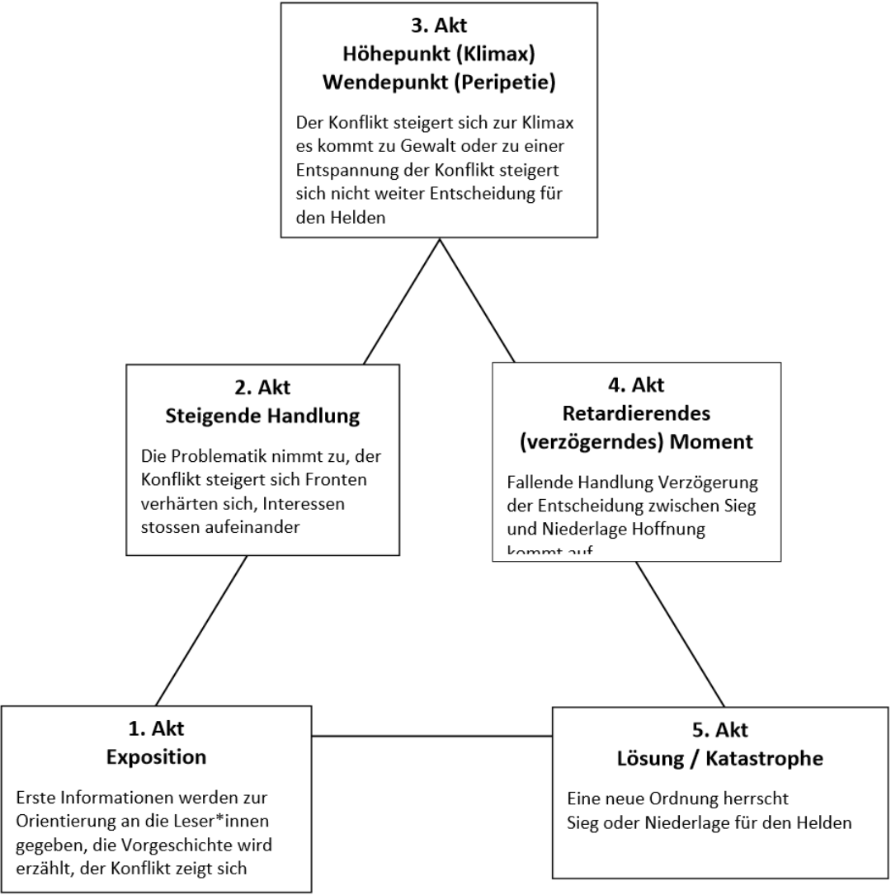

# Woyzeck

Siehe [diesen Artikel](https://www.stark-verlag.de/blog/georg-buechner-woyzeck)
für eine Zusammenfassung und detailiertere Erklärung zum Inhalt des Werks.

## Historischer Hintergrund

- **Vormärz (1830er Jahre)**: Epoche politischer Spannungen, gesellschaftlicher
  Umbrüche und Kritik an bestehenden Machtstrukturen

- **Georg Büchner**: Politischer Revolutionär, Naturwissenschaftler und
  Dramatiker

- **Der Hessische Landbote (1834)**:
    - Berühmtes Motto: *"Friede den Hütten! Krieg den Palästen!"*
    - Anklage gegen Ausbeutung der Landbevölkerung durch den Adel
    - Ungerechte Steuerverteilung zur Finanzierung von Hofhaltung und Militär

- **Fatalismus der Geschichte**: Erkenntnis Büchners über die Machtlosigkeit des
  Einzelnen gegenüber gesellschaftlichen Verhältnissen
    - Soziale Ungleichheit als einziges revolutionäres Element in der Welt
    - Menschen werden durch ihre Lebensumstände geformt und determiniert

- **Heinrich Heine &mdash; "Die schlesischen Weber" (1844)**: Literarische
  Anklage der Not der Unterschicht und fehlender gesellschaftlicher Empathie
    - Alliteration *"Wir weben, wir weben"* als Ausdruck anhaltenden Protests

## Charakterisierung und Soziale Stellung Woyzecks

- **Sozialer Stand**: Einfacher Soldat und Gelegenheitsarbeiter auf der
  untersten Stufe der Hierarchie

- **Persönlichkeitsmerkmale**: Passiv, leicht beeinflussbar, impulsiv

- **Psychischer Zustand**:
    - Bereits vor den medizinischen Experimenten psychisch instabil
    - Symptome von Paranoia, Verfolgungswahn und Halluzinationen
    - Psychische Belastung durch ständige Existenzangst und gesellschaftliche
      Demütigung

- **Entfremdung durch Armut**: Fehlen materieller Mittel verhindert Ausübung
  bürgerlicher Tugenden
    - Woyzecks Erkenntnis: _"Wenn ich reich wäre..."_

- **Beziehung zum Umfeld**:
    - Ausbeutung und Verspottung durch gesellschaftlich Höherstehende
    - Isoliert in der Gesellschaft; einziges Verantwortungsgefühl gilt seinem
      unehelichen Kind

## Sprachliche Gestaltung 

> Dieser Teil bezieht sich auf die Szene 5 (S.18f), welche wir im Unterricht
> besprochen haben.

- **Sprachliche Asymmetrie im Dialog**:
    - Hauptmann dominiert das Gespräch mit hohem Sprechanteil, Imperativen und
      Umgangssprache
    - Woyzeck antwortet in kurzen, abgehackten Sätzen, bemüht um respektvolle
      und reflexive Sprache

- **Religiöse Sprachprägung**: Woyzecks Denken und Wortschatz sind stark von
  biblischen Metaphern geprägt

- **Gegenüberstellung von Moral und Tugend**:
    - **Hauptmann**: Definiert Tugend als Selbstbeherrschung und Anstand,
      handelt aber selbst unmoralisch durch Machtmissbrauch und
      Empathielosigkeit
    - **Woyzeck**: Sieht Moral an Wohlstand gebunden; bürgerliche
      Moralvorstellungen sind für die Unterschicht kaum erreichbar

## Der Doktor

- **Erbsendiät des Doktors**: Woyzeck verpflichtet sich aus Geldnot zu einem
  dreimonatigen medizinischen Experiment

- **Entmenschlichung**: Herabstufung Woyzecks zum reinen Versuchsobjekt
  (_"Subject"_) und Datenpunkt

- **Menschenbild des Doktors**:
    - Vertritt wissenschaftlichen Positivismus und totale Kontrolle über den
      Körper
    - Behauptet theoretische Willensfreiheit, untergräbt diese jedoch in der
      Praxis

- **Verletzung der Menschenwürde**: Doktor nimmt körperliche und geistige
  Schäden Woyzecks billigend in Kauf

- **Motiv der Notwendigkeit**: Woyzeck erträgt das Experiment einzig zur
  finanziellen Versorgung von Marie und Kind

## Marie

- **Faszination für den Tambourmajor**: Attraktivität, physische Stärke und
  hoher gesellschaftlicher Status

- **Sehnsucht nach sozialem Aufstieg**:
    - Geschenkte Ohrringe als Statussymbol eines höheren Standes
    - Wunsch nach Anerkennung und Ausbruch aus dem Elend
    - Verstecken der Ohrringe vor Woyzeck aus Schuldgefühl[^1]

[^1]: Zwar _versteckt_ sie die Ohrringe nicht direkt, lügt Woyzeck aber an und
    sagt, sie habe die Ohrringe gefunden.

- **Gewissenskonflikt und Religion**:
    - Marie liest in der Bibel die Geschichte der Ehebrecherin
    - Schwanken zwischen Verlangen, Schuldgefühlen und Suche nach Vergebung

## Toxische Männlichkeit und Mord

- **Tambourmajor**:
    - Verkörperung toxischer Männlichkeit
    - Eigenschaften: Eitelkeit, Stolz, physische Aggressivität, exzessiver
      Alkoholkonsum
    - Definiert Männlichkeit über körperliche Dominanz und Unterwerfung anderer

- **Woyzeck als Gegenpol**: Pflichtbewusst, körperlich unterlegen, von
  Eifersucht und Existenzangst geplagt

- **Konflikt im Wirtshaus**: Physische Demütigung Woyzecks durch den
  Tambourmajor

- **Mord an Marie**: Reaktions- und Verzweiflungstat Woyzecks nach völligem
  Kontroll- und Ehrverlust &rarr; Mord als Folge gesellschaftlicher Zerstörung
  seiner Existenz

## Form

**Geschlossene** Form:

- **Drei Einheiten**: _Ein_ Raum, _ein_ Ort; die Handlung passiert an _einem_ Tag
- **Szenenstruktur**: Klare Abfolge (siehe Dramendreieck)
- **Sprache**: Verwendung von gehobener Kunstsprache
- **Figuren**: Oberschicht für Tragödie, Bürger für Komödie; begrenzte Anzahl
  Figuren

**Offene** Form:

- **Aufhebung der drei Einheiten**: Raum- und Zeitsprünge, eine Vielzahl an
  Orten
- **Szenenstruktur**: Lose Abfolge weitgehend autonomer Szenen
- **Sprache**: Verwendung von Alltagssprache, Dialekt und abgehackten
  Satzstrukturen
- **Figuren**: Protagonisten aus der untersten Sozialschicht anstelle der
  klassischen Hierarchie; viele Figuren

Georg Büchners _Woyzeck_:

- **Offenes** Drama
- Autor ist vor der Vollendung des Werkes gestorben
- Werk ist eine Rekonstruktion aus **vier** Entwurfsstufen

??? abstract "Dramendreieck nach Gustav Freytag"
    

## Historischer Kriminalfall

- **Reale Vorlage**: Johann Christian Woyzeck erstach 1821 in Leipzig die Witwe
  Woost aus Eifersucht

- **Biografische Parallelen**: Obdachlosigkeit, Soldatendienst, Armut und
  psychische Erkrankungen

- **Medizinisch-rechtliche Kontroverse**:
    - Gutachten von Dr. Clarus erklärte Woyzeck trotz deutlicher
      Psychoseanzeichen für zurechnungsfähig
    - Öffentliche Hinrichtung auf dem Leipziger Marktplatz 1824

- **Büchners Transformation**: Wandel einer reinen Kriminalsensation in eine
  sozialkritische Tragödie über gesellschaftliche Mitverursachung von Verbrechen

