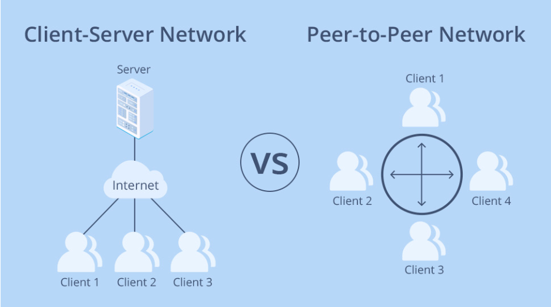
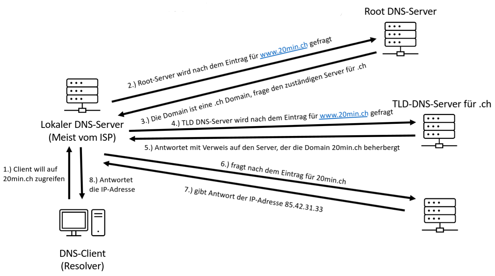
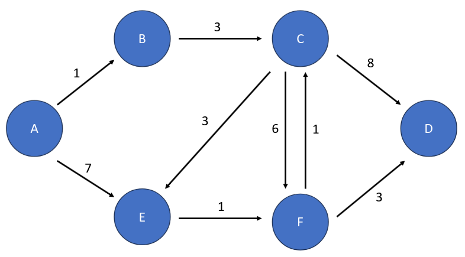
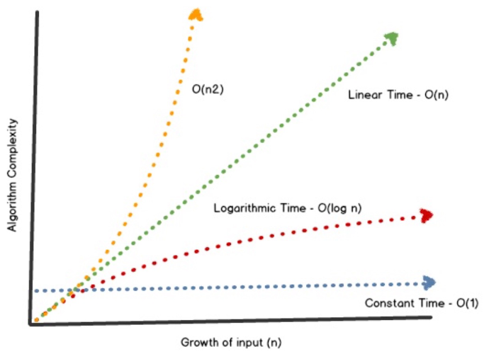
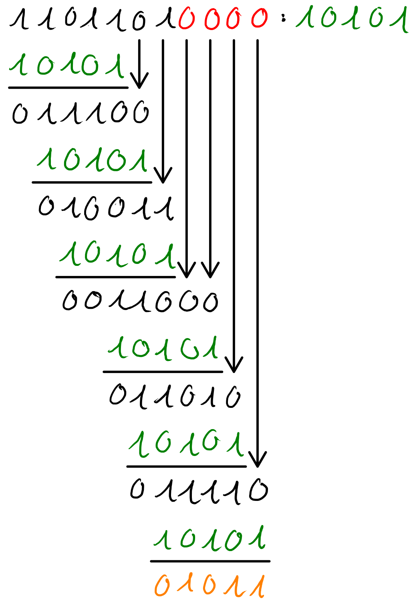
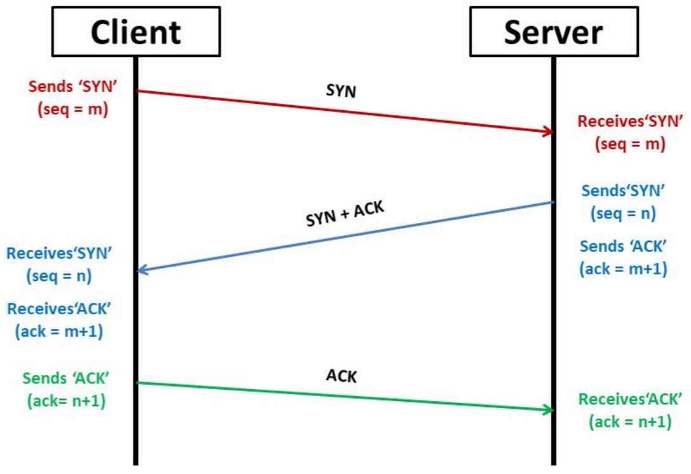

# Netzwerktechnik & Pen-Testing I

## Logik-Operatoren

- Logisches `NOT` $\lnot$ : Invertiert die Binärzahl
- Logisches `AND` $\land$ : $1$ wenn beide Inputs $1$ sind, sonst $0$
- Logisches `XOR` $\oplus$ : $1$ wenn genau ein Input $1$ ist, sonst $0$

## Netzwerke

- Netzwerk: Zusammenschluss mehrer Computer (via Kabel oder drahtlos)
- P2P: "peer to peer"; gleichberechtigte Computer, die direkt kommunizieren
- Server-Client: Hierarchie; Server stellt dem Client Ressourcen zur Verfügung

??? abstract "Netzwerktypen"
    

## IP-Adressen

- IPv4-Adresse: Adresse eines Gerätes im Internet
- besteht aus 4 Blocks (Oktette) mit je 8 Bits: `01011001 00010011 01110100
  10010011` / `89.19.116.147`
- benötigt, sodass ein Server die Antwort auf eine Anfrage an den richtigen Ort
  sendet
- Wird meist vom Router verteilt (DHCP[^2])

[^2]: **DHCP**: Dynamic Host Configuration Protocol

## Binär-System

- LSB0: Die Bitwertigkeit steigt von rechts nach links
- MSB0: Die Bitwertigkeit steigt von links nach rechts
- Stelle in der LSb0-Binärzahl steht für den Exponenten auf der $2$
    - `11010` &rarr; $1 \cdot 2^4 + 1 \cdot 2^3 + 0 \cdot 2^2 + 1 \cdot 2^1 + 0
      \cdot 2^0 = 26$
    - `10010110` &rarr; $2^7 + 2^4 + 2^2 + 2^1 = 150$
    - `110101` &rarr; $53$
- für MSB0 dasselbe, einfach umgekehrt
    - `11010` &rarr; $1 \cdot 2^0 + 1 \cdot 2^1 + 0 \cdot 2^2 + 1 \cdot 2^3 + 0
      \cdot 2^4 = 11$
    - `10010110` &rarr; $2^0 + 2^3 + 2^5 + 2^6 = 105$
    - `110101` &rarr; $43$

> Wir haben im Unterricht immer LSB0 verwendet

## IPv4-Knappheit

- IPv4: 4 Blocks mit je 8 Bits
- Anzahl verfügbare IPv4-Adressen: $2^{32} = 4'294'967'296$
- reicht nicht für die Menge an Geräten, die heutzutage IP-Adressen brauchen

Mögliche Lösungsansätze:

- **NAT** _(Network Adress Translation)_: Internetzugriff mehrerer Geräte findet
  über dieselbe IP-Adresse statt (Private vs. Public IP Adress)
- **Subnetting**: effizientere Nutzung von IP-Blöcken durch Unterteilung
  mithilfe von Subnetzmasken (CIDR)
- **IPv6**: Ein neuer IP-Standard mit längeren Adressen (128 Bits in 8 Blöcken
  &rarr; $2^{128} \approx 3.4 \cdot 10^{38}$ Möglichkeiten)

## Subnetting

- **Subnetzmaske**: 32-Bit Nummer, die eine IP-Adresse in Netzwerk und
  Host-Adresse unterteilt
    - **CIDR-Notation**: `/x` &rarr; `x` $1$-Bits gefolgt von `32 - x` $0$-Bits
    - `/17` &rarr; Subnetzmaske:  = `1111 1111 1111 1111 1000 0000 0000 0000` =
      `255.255.128.0`
- **Netzwerk-ID**: 32-Bit Nummer, die angibt, in welchem Netzwerk sich eine
  IP-Adresse befindet
    - Berechnung: `[IP-Adresse] AND [Subnetzmaske]`
    - `192.168.3.7/24` &rarr; Netzwerk-ID: `192.168.3.0`
    - `192.168.3.239/22` &rarr; Netzwerk-ID: `192.168.0.0`
    - `192.168.128.48/22` &rarr; Netzwerk-ID: `192.168.128.0`
- **Anzahl IP-Adressen**:
    - erste Adresse im Netzwerk ist die Netzwerk-ID &rarr; kann nicht vergeben
      werden
    - letzte IP-Adresse im Netzwerk ist die **Broadcast-IP** &rarr; kann nicht
      vergeben werden
    - verteilte IP-Adressen enden also **nie** mit `.0` oder mit `.255`
    - für jedes Subnet bleiben `(NOT [Subnetzmaske]) - 2` brauchbare IP-Adressen
      übrig
- **Switch vs. Router**
    - **Switch**: Verwendet MAC-Adressen[^3]; ist deshalb nur in lokalen
      Netzwerken geeignet
    - **Router**: Verwendet IP-Adressen; ist bei der Verbindung von zwei
      Netzwerken erforderlich

[^3]: **MAC**: Media Access Control

## DNS

- **DNS**: Domain Name System
- IP-Adressen sind die "Adressen" von Computer, während die Domain die Adresse
  eines bestimmten Services darstellt
- Domains können auf beliebige IP-Adressen zeigen &rarr; es braucht einen Index
- ein DNS Server hat solche Listen oder weiss, wo sie zu finden sind
- **DNS-Servers**
    - Root-Server: Verantwortlich für gewisse Erdregionen; geben Verweise zu
      TLD-Server
    - TLD-Server: Verantwortlich für gewisse Toplevel Domains; geben Verweise zu
      autoritativen Server
    - autoritative Server: Beinhalten Domain &harr; IP Einträge, die abgefragt werden
      können

??? abstract "Ablauf einer DNS-Anfrage"
    

## Dijkstra

> Eine ziemlich coole Visualisierung ist [hier](https://www.davbyjan.com/) zu
> finden.

- Greedy-Algorythmus, um den **kürzesten Pfad** durch einen Graphen zu finden
  (ohne negative Kantengewichte)
- Anwendung: Kürzester Weg von A nach B in einem Netzwerk
- Laufzeit: $O(V + E \cdot \log(V))$, wobei $V$ die Anzahl Knoten und $E$ die
  Anzahl Kanten ist
- **Vorgehen**:
    1. Beginn mit Start-Knoten (hier A)
    2. Beim aktuellen Knoten ein "&ndash;" in die Tabelle schreiben
    3. Für alle anderen Knoten in der Tabelle die Werte aktualisieren:
        - Wenn der Knoten bereits ein "&ndash;" hat: &ndash;
        - Wenn der Knoten erreichbar ist und dies in einer vorherigen Runde noch
          nicht war: (Distanz bis zum aktuellen Knoten + Gewichtung) +
          Bezeichnung des aktuellen Knoten
        - Wenn der Knoten erreichbar ist und das in einer vorherigen Runde
          bereits war: (Distanz bis zum aktuellen Knoten + Gewichtung) +
          Bezeichnung des aktuellen Knoten, falls die neue Distanz kleiner ist
          als die vorher bestimmte Distanz. Ansonsten, die vorher bestimmte
          Distanz erneut eintragen
        - Wenn der Knoten nicht erreichbar ist: &infin; falls der Knoten noch
          nie erreicht wurde. Ansonsten, die vorher bestimmte Distanz erneut
          eintragen
    4. Für die nächste Runde wird der Knotenpunkt mit der tiefsten Distanz
    gewählt, der noch nie betrachtet wurde. Mit dem aktualisierten Startknoten
    wieder bei Schritt 2. beginnen

??? example "Beispiel"
    

    |   | A       | B       | C       | D       | E       | F       |
    |---|---------|---------|---------|---------|---------|---------|
    | A | &ndash; | **1A**  | &infin; | &infin; | 7A      | &infin; |
    | B | &ndash; | &ndash; | **4B**  | &infin; | 7A      | &infin; |
    | C | &ndash; | &ndash; | &ndash; | 12C     | **7A**  | 10C     |
    | E | &ndash; | &ndash; | &ndash; | 12C     | &ndash; | **8E**  |
    | F | &ndash; | &ndash; | &ndash; | **11F** | &ndash; | &ndash; |
    | D | &ndash; | &ndash; | &ndash; | &ndash; | &ndash; | &ndash; |

??? abstract "Darstellung von Zeitkomplexitäten"
    

## CRC (Cyclic Redundancy Check)

- Methode zur **Berechnung von Prüfwerten** (checksums), die auch für
  Rekonstruktion verwendet werden können
- **Binär- und Polynomrepräsentation**: Stelle in der LSb0-Binärzahl
  steht für den Exponenten der Variable
    - `11010` &rarr; $1 \cdot x^4 + 1 \cdot x^3 + 0 \cdot x^2 + 1 \cdot x^1 + 0
      \cdot x^0 = x^4 + x^3 + x$
    - `10010110` &rarr; $x^7 + x^4 + x^3 + x$
    - `110101` &rarr; $x^5 + x^4 + x^2 + 1$
- Länge des Generatorpolynoms bestimmt die Länge der Prüfsumme &rarr; je länger,
  desto mehr Daten sind beinhaltet, desto besser kann also auch überprüft und
  rekonstruiert werden

???+ example "Beispiel: CRC Anwendung"
    Der Prüfwert der Nachricht $m(x)$ sollte mit dem Generatorpolynom $g(x)$ berechnet werden:

    $$
    \begin{align}
    m(x) &= x^6 + x^5 + x^3 + x^2 + x^0 \\
    g(x) &= x^4 + x^2 + 1
    \end{align}
    $$

    In der Binärschreibweise sehen diese wie folgt aus:

    $$
    \begin{align}
    m &= 1101101 \\
    g &= 10101
    \end{align}
    $$

    **Vorgehen**:

    1. der Binärdarstellung der Nachricht werden so viele Nullen angehängt wie
       der höchste Grad des Generatorpolynoms
    2. Teilen durch den Generatorpolynom unter Anwendung des `XOR`-Operators
    3. der Rest der Division ist die **Prüfsumme** &rarr; am Ende der Nachricht
       anhängen

    ??? note "Teilung durch Generatorpolynom"
        - höchster Grad des Generatorpolynoms: 4 (hier rot markiert)
        - Rest der Division: 01011 (hier orange markiert)

        

    Finale Nachricht: `110110101011`

    ---
    Damit der Empfänger der Nachricht dessen Integrität überprüfen kann, muss
    dieser den erhaltenen Bit-String erneut durch das Generatorpolynom teilen.
    Wenn der Rest $0$ herauskommt, wurde die Nachricht vollständig und korrekt
    übertragen.

## Pen-Testing

**VMs** _(Virtual Machines)_:

- Computerumgebungen, die das Gefühl haben, auf physischer Hardware zu laufen,
  die aber nur simuliert sind
- schnelle Wiederherstellung von Systemen ohne Kollateralschaden
- Systeme sind isoliert
- Ressourcen werden abgegrenzt

**Kali Linux**:

- Linux-Distribution
- viele Hacking-Tools vorinstalliert
- System auf Pen-Testing ausgelegt

**Ports**:

- Erweiterung der IP-Adresse um `:XXXX` (z.B. `192.168.1.70:443`)
- benötigt, damit mehrere Services gleichzeitig auf demselben Computer laufen
  können
- bestimmte ports werden typischerweise für bestimmte Anwendungen eingesetzt;
  einige Beispiele:
    - 80: HTTP
    - 443: HTTPS
    - 22: SSH
    - 20: FTP

**TCP** _(Transmission Control Protocol)_:

- zuverlässig &rarr; garantierte Zustellung des Pakets; Fehlerkorrektur
- Bestätigungen (ACKs) und Paketwiederholungen
- Verbindungsaufbau mittels 3-Way-Handshake
- langsamer, mehr overhead
- Anwendungen: HTTP(S), SMTP/IMAP/POP, FTP, SSH, SQL, ...

**UDP** _(User Datagram Protocol)_:

- unzuverlässig &rarr; Pakete werden einfach mal abgeschickt
- keine Bestätigungen, verlorene Daten werden nicht erneut verschickt
- kein Verbindungsaufbau &rarr; wenn der Empfänger nicht bereit ist, pech gehabt
- Anwendungen: ursprünglich Telefon (VoIP), heute auch Streaming, IoT, DNS, ...

??? abstract "Ablauf des 3-Way-Handshakes"
    

## Netzwerkscans

### SYN Scan

- sucht nach offenen TCP-Ports
- bricht Verbindung ab, sobald Anzeichen für einen offenen Port bestehen
- schnell &rarr; kein langer Datenaustausch
- Tarnung: viele Systeme erkennen solche scans nicht als fragwürdig
- benötigt Adminrechte auf dem client-System zum Zusammenstellen von rohen
  IP-Paketen

Vorgehen:

1. sendet nur den `SYN`-Teil des Handshakes
2. wenn der Server mit `SYN-ACK` antwortet, ist der port offen
3. client sendet direkt `RST` (Reset), um die Verbindung abzubrechen

### TCP Scan

- sucht nach offenen TCP-Ports
- beendet den 3-Way-Handshake, bevor die Verbindung unterbrochen wird
- langsam &rarr; voller Handshake muss durchlaufen werden
- viele Systeme halten den Verbindungsversuch in logs fest
- benötigt **keine** Adminrechte auf dem client-System, da es die
  Netzwerk-Funktionalität des Betriebssystems nutzt

### UDP Scan

- sucht nach offenen UDP-Ports
- schickt ein leeres oder portspezifisches Datenpaket und wertet die Antwort des
  Servers aus:
    - normale Antwort &rarr; port ist offen
    - keine Antwort &rarr; port ist offen oder gefiltert
    - `ICMP Port Unreacheable` &rarr; port ist geschlossen
- sehr langsam; ein voller scan kann Stunden dauern
- viele Betriebssysteme limitieren die Anzahl Fehlermeldungen &rarr; noch
  langsameres Vorgehen
- keine Empfangsbestätigungen &rarr; man muss Pakete oft mehrmals verschicken
