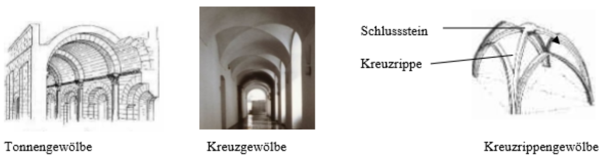
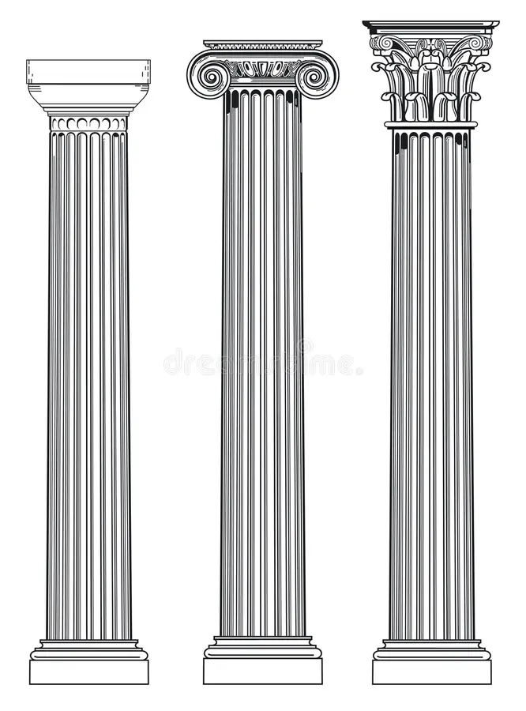

# 1 - Architektur I

## Fachbegriffe

| Begriff | Erklärung |
| --- | --- |
| Arkade | Eine auf Pfeilern oder Säulen ruhende Bogen**folge** |
| Grundriss | Massgerechter Schnitt durch Bauwerk &rarr; Lage der **Mauern, Räume, Türen, Fenster** |
| Aufriss | Massgerechte Darstellung von Bauwerk &rarr; **Gliederung, Ansicht Wände** |
| Schnitt | Massgerechter vertikaler Schnitt durch Bauwerk zur Darstellung des inneren Aufbaus |
| Beton | Künstliches Gestein; einfach formbar, druckfest, **niedrige Zugfestigkeit** |
| Stahlbeton | Beton und Stahl; druck- und zugbelastbar |
| Bogen | **Rund**bogen &rarr; bogenlinie ist Kreisförmig und 180°; **Spitz**bogen &rarr; zwei separate Kreissegmente |
| Strebewerk | System von Strebepfeilern und Strebebögen zum Auffangen des Seitenschubs von Gewölben |
| Strebepfeiler | Pfeiler im Strebewerk zur Stabilisierung einer Wand |
| Strebebogen | Verbindung zwischen Mauer und Strebepfeiler |
| Tragwerk | Statisches Gesamtsystem der tragenden Elemente |
| Fachwerk | Gerüst in **Skelettbauweise** mit Querverbindungen und Streben |
| Träger | Tragender Balken aus Holz, Stein, Stahl, Stahlbeton usw. |
| Fiale | **Gotisches** Architekturelement &rarr; Spitztürmchen als Verzierung von Strebepfeilern |
| Gebälk | Alle Balken einer Dachkonstruktion |
| Gelenkrahmen / Gelenkbogen | Tragsystem zur Ableitung der Kräfte auf die Gelenke |
| Gesims | Horizontales Bauelement zur Gliederung der Aussenwand in Abschnitte   Unterschieden zwischen **Sockel-**, **Stockwerk-** und **Dach**gesims |
| Giebel | Abschlussform eines Gebäudes/Daches oder Bekrönung eines Bauteils |
| Giebelfeld | Oberfläche eines Giebels |
| Kapitell | Kopfstück einer **Säule** |
| Säulengang | Arkade aber mit geradem Gebälk |
| Massivbauweise | Wände und Decken sind tragend |
| Skelettbau | Tragendes Skelett &rarr; Primärkonstruktion; nicht tragende Elemente (Wände, Decken usw.) &rarr; Sekundärkonstruktion |
| Masswerk | Dient der Unterteilung von Bauelementen in der **Gotik** |
| Säule | Stützglied mit kreisfärmigen Grundriss &rarr; Gliederung in **Basis**, **Schaft** und **Kapitell** |
| Pfeiler | Stützglied mit polygonalem Grundriss |
| Piano nobile | Hauptgeschoss eines Palasts/Schlosses; ausgefeilter als der Rest des Gebäudes |
| Pilaster | Flache Wandvorlage mit Basis und Kapitell |
| Portikus | Von Säulen oder Pfeilern getragene Vorhalle eines Gebäudes |
| Profanbau | Weltliche Architektur |
| Sakralbau | Architektur für kultische oder kirchliche Zwecke |
| Triumphbogen | Ehrenbogen zur Erinnerung an z.B. Schlacht; höhere Mittlere Öffnung; optionale niedrigere Seitenöffnungen |
| Zentralbau | Baukörper mit etwa gleich langen Hauptachsen &rarr; hat keine spezifische Richtung[^1] |

[^1]: Oft Grundformen als Grundriss: Kreis, Quadrat, Oval, Griechisches Kreuz

### Gewölbeformen

- **Tonnengewölbe**: halbkreisförmiger Querschnitt
- **Kreuzgewölbe**: Durchdringung zweier Tonnengewölbe im 45°-Winkel
- **Kreuzrippengewölbe**: Kreuzgewölbe mit verstärkten Schnittstellen (&rarr;
  Rippen)

??? abstract "Beispiele für Gewölbeformen"
    

### Säulen

Aus der Griechischen Baukunst sind drei **Kapitellformen** entstanden:

- **dorisch**:
- **ionisch**:
- **korinthisch**

Später entstand das Römische **Kompositkapitell** als Mischung aus ionisch und
korinthisch.

> **Säulenordnung**: Abstimmung von Säulen, Kapitellen, Architraven und Gesims
> auf einander

??? abstract "Vergleich der Kapitellformen"
    von Links nach Rechts: dorisch, ionisch, korinthisch
    

## Epochen

**Griechische Antike**:

- ca. 1200 v. Chr. &ndash; 100 n. Chr.
- **Tempel** als wichtigster Bautypus &rarr; Wohnhaus eines Gottes
- Konstruktion folgt mathematischen Gesetzmässigkeiten
- Ordnung, Mass, Proportion, Gleichgewicht
- Ursprung der [Säulenordnungen](#saulen)

**Römische Antike**:

- ca. 4. Jh. v. Chr. &ndash; 6. Jh. n. Chr.
- Architektur stark von den Griechen beeinflusst
- Bogenformen und Arkaden
- Klar durch Gesimse definierte Stockwerke, welche sich visuell wiederholen

**Gotik**:

- ca. 1130 &ndash; 1500
- Kaum von Römischer Architektur geprägt
- Hochstrebende Bauwerke
- Neue Verteilung der Druckkräfte aufgrund des Strebewerkes
- zentrale Fensterrose für viele Sakralbauten
- Kirchenbauten als Abbild des himmlischen Jerusalems
- Grosse Fenster

**Renaissance**:

- ca. 1420 &ndash; 1620
- "Wiedergeburt" der Antike im Sinne des Denkens und der Weltsicht
- Weltliche Existenz des Menschen im Mittelpunkt
- Verwendung einfacher, regelmässiger Formen (auch im Grundriss)
- Gotische Pfeiler werden wieder durch die klassische Säulenordnung ersetzt

> Die Spitzbögen der Gotik wurden zunächst wieder durch Rundbögen ersetzt,
> später rechteckig gemacht und mit einem Dreiecksgiebel _(Segmentgiebel)_
> überdacht.

**Barock**:

- ca. 1600 &ndash; 1750
- "dynamisierte Renaissance"
- Mischung aus Architektur, Malerei und Skulptur
- Geschwungene, konkave und konvexe Formen in Grund- und Aufriss
- Reich beschmückt mit dem Ziel, zu beeindrucken
- Symmetrischer Aufbau; Betonung der Mittelachse
- Portal _(Türe)_ ist hervorgehoben
- Ovale Form in Grundriss von Sakralbauten
- Feiern der Grösse von Glaube und Macht

**Historismus**:

- ca. 1840 &ndash; 1900
- Wiederaufleben verschiedener Stilrichtungen
- Schematische Nachahmung statt neuer Interpretation
- Teilweise Kombination von mehreren Stilrichtungen

> **Neogotik, Neorenaissance und Neobarock** sind die historistischen
> Interpretationen des ursprünglichen Stils. _Neo-Antike_ gibt es **nicht**, da
> der Stil bereits in der Renaissance wieder aufgegriffen wurde.

**Jugendstil**:

- 1893 &ndash; 1914
- Architektur wird in Verbingung mit Kunst gebracht
- Ablenung der traditionellen Architekturformen des Historismus
- Orientierung an Formen der Natur
- Neue Baumaterialien (Eisen und Glas)
- In ganz Europa verbreitet, aber je nach Ort unterschiedlich

**Internationaler Stil**:

- ab 1920
- Moderne Materialien: Beton, Stahl, Glas
- Verzicht auf Ornamente und Verzierungen
- Skelettbau ermöglicht primär aus Glas bestehende Fassaden
- Wirkung: transparent, leicht, schlicht; teils minimalistisch-streng

**Organische Architektur / Skulpturale Architektur**:

- ab ca. 1925
- Gegenstück zu internationalem Stil
- Bauwerk und Natur sollten in einander übergehen
- Runde, geschwungene und teils asymetrische Bauformen
- Nutzung von Baumaterialien, welche vor Ort vorhanden sind
- Spannbeton oder Stahlbetonschalen ermöglichen Stabilität trotz schwieriger
  Formen

**Dekonstruktivismus**:

- ab 1985
- Empfinden der Destabilisierung
- Fragmentierte, zerstückelte Bauformen
- Bauten erscheinen technisch unmöglich
- Ungewöhnliche Materialverwendung
- Unregelmässige, schräge Formen
- Untergeordnete Bauteile können stark überbetont werden
- Entwicklung mittels computerbasierter Software

## Modernes Wohnen

### Urban Mining

Ziele:

- Materialien / Baustoffe aus alten Bauten zurückgewinnen
- Materialien in einem neuen Bauwerk verwenden, statt sie wegzuwerfen

Ansätze:

- Trennung der Baustoffe beim Bau neuer Gebäude[^2]
- **Upcycling**: Nutzung alter Materialien auf neue Arten _(z.B. Isolation aus
  alten Jeans)_

Vorteile:

- Umweltschutz; Wiederverwendung der Materialien bei neuen Bauprojekten
- Sparen von Baumaterialien &rarr; Sparen von Kosten
- Reduktion von Abfallprodukten
- Ermöglicht temporäre Bauwerke

[^2]: So können die Baustoffe einfach wieder aus einander genommen werden, wenn
    das Gebäude abgerissen wird

### Microliving

- Wohnen auf sehr kleinem Raum
- Multifunktionalität von Wänden, Möbeln usw.
- Platz soll möglichst effizient genutzt werden

Pro:

- Platzmangel in Städten
- Immer mehr Menschen wohnen alleine &rarr; brauchen nicht so viel Platz
- Personen sind viel unterwegs und gar nicht zu Hause
- Möglichkeit, alte Büroflächen / -Gebäude zu nutzen
- Anpassbare Wohnelemente
- Interessierte Investoren

Contra:

- Keine "traditionelle" Zimmerstruktur
- Viele steigen (noch) nicht freiwillig um
- Erhöhter Bedarf an Disziplin und Ordnung

